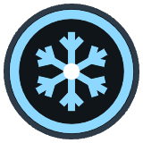

<!-- Written by tools/wiki/run.lua from the game's code (`make wiki`): change the game, not this page. -->

# Freeze

[Wiki](../README.md) / [Abilities](README.md) / Freeze

A moment after you cast it, everything in the target area stops dead for a few seconds: players, cars, the crowd. Never you.

**How to use it:** Press its key, then click where to land.

| | |
|---|---|
| **Kind** | active (a key) |

## Stats by tier

| | Common | Uncommon | Rare | Legendary |
|---|---|---|---|---|
| **cooldown** | 12 s | **10.4 s** | **9.6 s** | **8.9 s** |
| **duration** | 3 s | 3 s | **3.8 s** | **4.1 s** |
| **area** | 110 px | 110 px | 110 px | **149 px** |
| **reach** | 380 px | 380 px | 380 px | **513 px** |
| **better by** | - | +15% cooldown | +25% cooldown, duration | +35% all |
| **price** | 80 Fcks | 200 Fcks | 480 Fcks | 1200 Fcks |

_What a tier improves is in **bold**._

## How to get it

- In the shop, in every tier: 80 Fcks for a common one.
