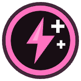

<!-- Written by tools/wiki/run.lua from the game's code (`make wiki`): change the game, not this page. -->

# Second wind

[Wiki](../README.md) / [Abilities](README.md) / Second wind

Stop spending stamina for a moment and your breath comes back fast.

**How to use it:** Passive: it works from the passive slot, no key.

| | |
|---|---|
| **Kind** | passive (works from the passive slot) |

## Stats by tier

| | Common | Uncommon | Rare | Legendary |
|---|---|---|---|---|
| **rest** | 12 s | **10.4 s** | **9.6 s** | **8.9 s** |
| **recovery rate** | 20 stamina/s | 20 stamina/s | **25 stamina/s** | **27 stamina/s** |
| **duration** | 3 s | 3 s | 3 s | **4.1 s** |
| **starts after** | 1 s | 1 s | 1 s | **0.7 s** |
| **better by** | - | +15% cooldown | +25% cooldown, recovery rate | +35% all |
| **price** | 80 Fcks | 200 Fcks | 480 Fcks | 1200 Fcks |

_What a tier improves is in **bold**._

## How to get it

- In the shop, in every tier: 80 Fcks for a common one.
- Dropped by [The Runner](../enemies/events-runner.md) (The city): 40 koins, and his second wind in a random tier (legendary 3 times in a hundred).
