<!-- Written by tools/wiki/run.lua from the game's code (`make wiki`): change the game, not this page. -->

# Enemies

[Wiki](../README.md) / Enemies

Everyone and everything in the game that fights back, by where you meet them. Bosses are in **bold**.

## The city

| | Enemy | Health | Where |
|---|---|---|---|
| 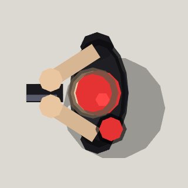 | [Hangout guard](gang-hangout-guard.md) | 60 (Street thugs) to 90 (Combine) | The city, on the sidewalk in front of a player's Gang Hangout |
| 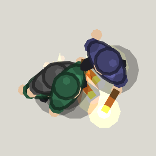 | [Simp (open borders)](open-borders-simp.md) | 40 | Wherever somebody casts the open borders ability, round the one who cast it |
|  | [Police officer](police-officer.md) | 50 | The city's streets, walking a beat near every player |
| 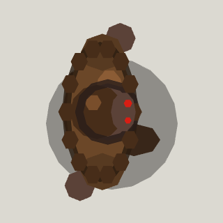 | **[Bigfoot (city event)](events-bigfoot.md)** | 2500 | The city, as an event once the job "The truth is out there (in the woods)" is done: he comes out onto a road away from everyone |
| 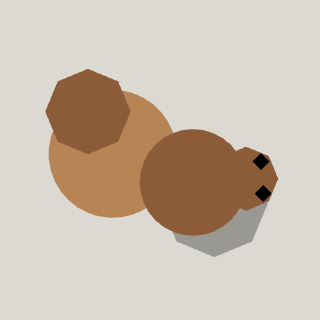 | [Squirrel (Bigfoot's)](events-squirrel.md) | 10: one hit of anything | The city, round Bigfoot's feet while his event is on |
| 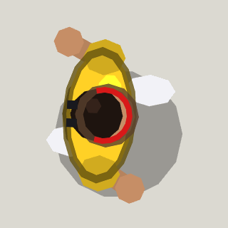 | **[The Runner](events-runner.md)** | 1200 | The city, as an event: he comes onto a crossing away from everyone |
| 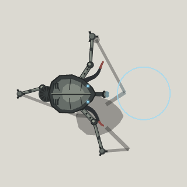 | **[The Tripod](events-tripod.md)** | 4000 | The city, as an event: it rises out of a lightning storm at a crossing |
|  | **[A-Man (city event)](a-man-event.md)** | 1400 | The city, as an event once the job "The man with the moustache" is done: he walks in from somewhere away from everyone |

## Karen's Cul-de-sac

| | Enemy | Health | Where |
|---|---|---|---|
| 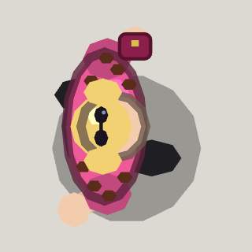 | **[Crazy Karen](karen-boss.md)** | 1500 | Karen's Cul-de-sac, in the turning circle at the end of her street |
| 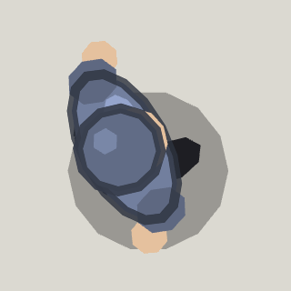 | [Simp](karen-simp.md) | 40 | Karen's Cul-de-sac, turning up round her while she stands |

## Whispering Pines

| | Enemy | Health | Where |
|---|---|---|---|
| 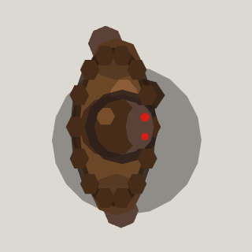 | **[Bigfoot](alien-hunt-bigfoot.md)** | 1800 | Whispering Pines, in the fifth clearing at the end of Wendell's trail |
| 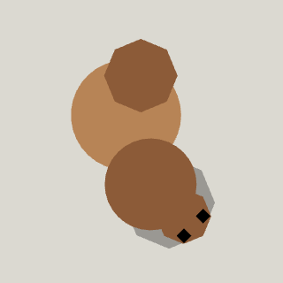 | [Squirrel](alien-hunt-squirrel.md) | 30 | Whispering Pines, out of the trees at each of the first four clearings |

## D-Day

| | Enemy | Health | Where |
|---|---|---|---|
| 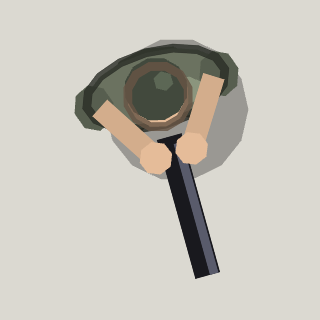 | [D-Day soldier](d-day-soldier.md) | 40 | Looz'er Beach: guards in the bunkers, trenches and huts, riflemen out of the barracks |
| 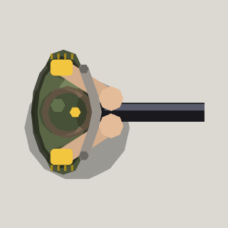 | **[Major Looz'er](d-day-major.md)** | 2200 | Looz'er Beach, on the hilltop behind the flag once someone reaches it |

## Shotgun's Bluff

| | Enemy | Health | Where |
|---|---|---|---|
| 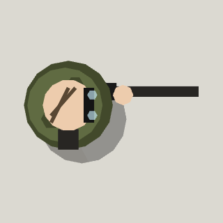 | **[Shotgun](shotgun-boss.md)** | 1600 | Shotgun's Bluff, on the plateau above the meadow |

## A-Man

| | Enemy | Health | Where |
|---|---|---|---|
| 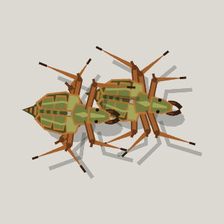 | [Antlion](antlions-antlion.md) | 36 | The Coast, buried in swarms in the sand; A-Man's briefcase calls them up in the Citadel |
| 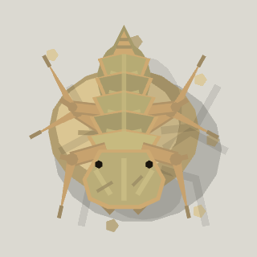 | **[Antlion Guard](antlions-guard.md)** | 2400 | The Coast's point, up out of the sand once the last section is cleared |
| 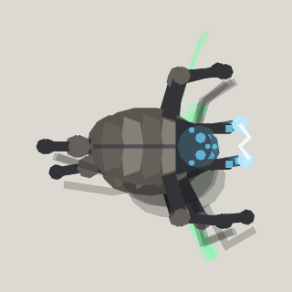 | [Hunter](hunters-hunter.md) | 180 | City 17 round the Citadel, the Winding Road and the Citadel; the Hunter-Chopper and A-Man's finale bring more in |
| 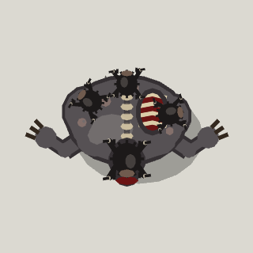 | **[Poison Zombie](poison-zombie-zombie.md)** | 1800 | The Winding Road, waiting on the pass at the top |
| 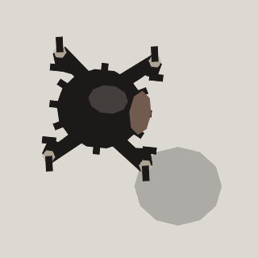 | [Poison headcrab](poison-zombie-headcrab.md) | 30 | The Winding Road's pass, thrown off the Poison Zombie's back |
| 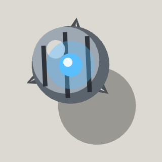 | [Rollermine](rollermines-rollermine.md) | 40 | Sunk in the ground on the Winding Road and in the Citadel; A-Man's finale sets more down already awake |
| 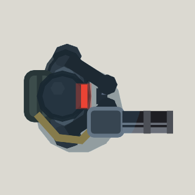 | [Suppressor](suppressors-suppressor.md) | 220 | The Citadel, holding the gallery and the reactor deck |
| 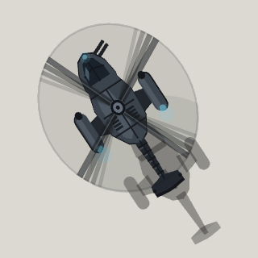 | **[Hunter-Chopper](hunter-chopper-chopper.md)** | 3600 | The Outer City, circling the square on the island from the moment you arrive |
| 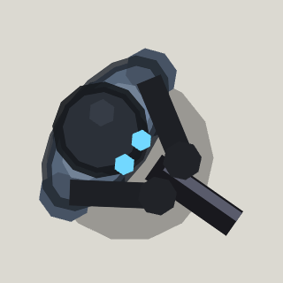 | [Combine soldier](a-man-combine.md) | 60 | Every map of A-Man's trail, from City 17 to the Citadel |
| 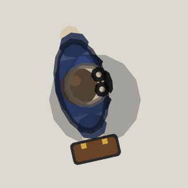 | [A-Man, passing through](a-man-cameo.md) | can't be hurt here | City 17's plaza, the first time anyone walks into it |
| 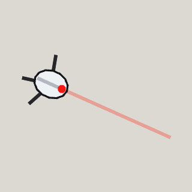 | [Sentry turret](a-man-cameo-turret.md) | 1 | Out of A-Man's briefcase: City 17's plaza, the top of the Citadel and his city event |
| 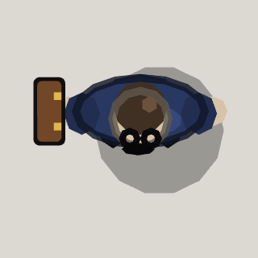 | **[A-Man](a-man-finale.md)** | 5000 | The top of the Citadel, once someone steps onto the top platform |

## Cyber Feud

| | Enemy | Health | Where |
|---|---|---|---|
| 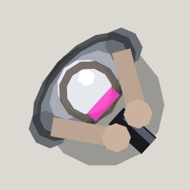 | [Halcyon officer](cyber-feud-halcyon-soldier.md) | 60 | Every map: roadblocks and squads on the Drop, the Market's east side, the Overpass's checkpoints, every floor of the tower, the Roof's dropship |
| 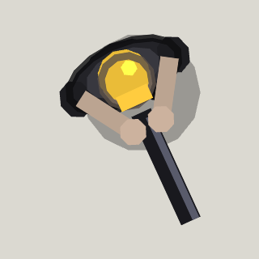 | [Elite officer](cyber-feud-elite-officer.md) | 180 | The Roof: one with each of the dropship's drops from the second on |
| 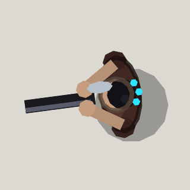 | [Static ganger](cyber-feud-static-soldier.md) | 50 | The Drop's corners and blocks, the Market's west and its chop shop, the Overpass's shoulders and the Knot, Halcyon Tower breaking in from below |
| 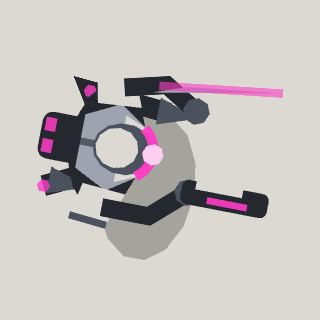 | [Assassin droid](cyber-feud-droid.md) | 240 | The Drop's last crossings before the tunnel, Halcyon Tower's server room, labs and executive floor, and the Roof with the dropship |
| 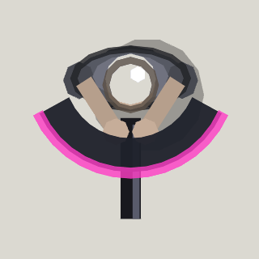 | [Enforcer](cyber-feud-enforcer.md) | 120 | The Market's south gates, in front of the Overpass's roadblocks, Halcyon Tower's guard and executive floors, and the Roof with the dropship |
| 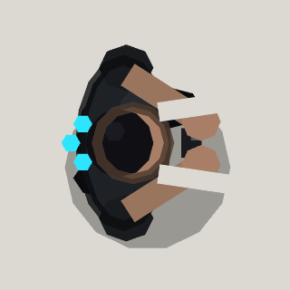 | [Ripper](cyber-feud-ripper.md) | 40 | The Market's west lanes, walking the Static's beats |
| 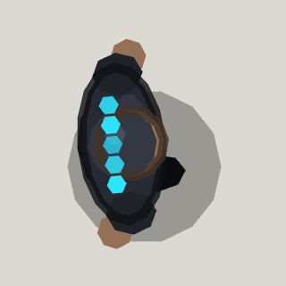 | [Sparker](cyber-feud-sparker.md) | 40 | The Market's west lanes and General Volt's backup, and Halcyon Tower with the break-ins from floor 2 up |
| 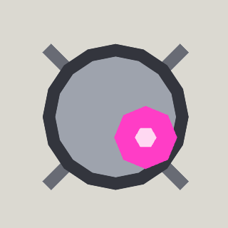 | [Watcher drone](cyber-feud-watcher.md) | 20 | Over the Market's stalls, and in Halcyon Tower's lobby and offices |
|  | **[General Volt](cyber-feud-volt.md)** | 1800 | The Market's Noodle Square, holding the loading dock's pass code |
|  | [Interceptor](cyber-feud-interceptor.md) | 220 | The Overpass, parked on the shoulder to pull out after whoever drives past |
|  | [War-rig](cyber-feud-war-rig.md) | 380 | The Overpass, parked on the shoulder between Halcyon's interceptors |
| 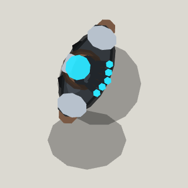 | [Kilowatt (on the Overpass)](cyber-feud-kilowatt-cameo.md) | - | The Overpass, roaring past on his own rig 11 s after you arrive, or once somebody drives off |
| 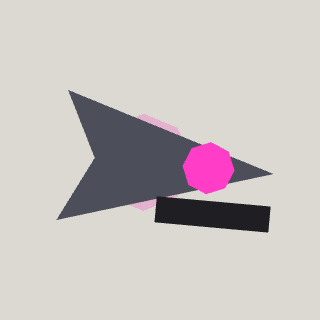 | [Sting drone](cyber-feud-sting.md) | 20 | Swarms over the Overpass's gantries, and in Halcyon Tower's server room |
| 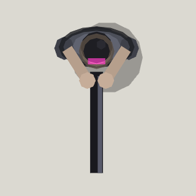 | [Marksman](cyber-feud-marksman.md) | 40 | Up on the Overpass's gantries, and in the far corners of Halcyon Tower's guard and executive floors |
| 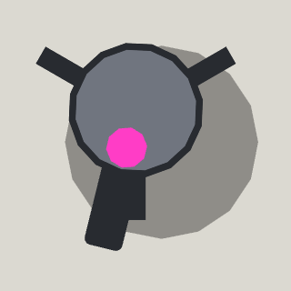 | [Sentry turret](cyber-feud-turret.md) | 80 | Bolted down in Halcyon Tower's labs and round its security floor; on the Roof, dropped by Saye and driven by VEX |
| 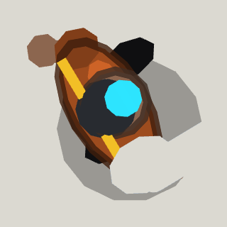 | [Brute](cyber-feud-brute.md) | 150 | Halcyon Tower with the Static's break-ins from floor 3 up, and the Roof: up the stairs while Kilowatt fights, and with the dropship |
|  | **[Kilowatt](cyber-feud-kilowatt.md)** | 2400 | The Roof, on the helipad, from the moment it wakes |
| 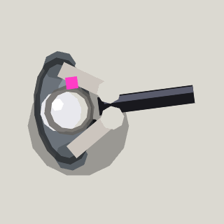 | **[Director Saye](cyber-feud-saye.md)** | 2000 | The Roof, by the billboard, from the moment it wakes |
| 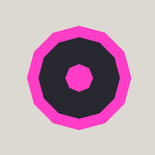 | [Executive drone](cyber-feud-saye-drone.md) | 30 | The Roof, orbiting Director Saye |
| 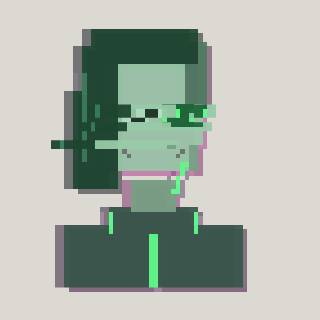 | **[VEX](cyber-feud-vex.md)** | - | The Roof, once Saye and Kilowatt are down and the Shard is in her uplink |
|  | [Halcyon dropship](cyber-feud-dropship.md) | - | Over the Roof, while VEX has it |

## Eternal Mood

| | Enemy | Health | Where |
|---|---|---|---|
| 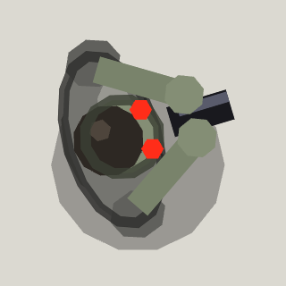 | [Zombie staffer](eternal-mood-staffer.md) | 40 | Fobos Base, Heck on Earth and the Foundry, at desks and posts and on patrol |
| 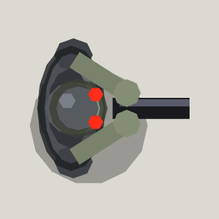 | [Zombie guard](eternal-mood-guard.md) | 60 | Fobos Base, Heck on Earth and the Foundry, watching doorways and walking patrols |
| 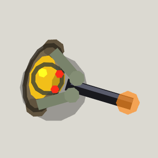 | [Overtime guy](eternal-mood-overtime.md) | 100 | Fobos Base by the hangar lift, Heck on Earth's overpass and starport gate, and the Foundry |
| 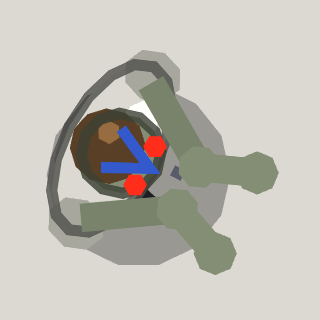 | [Intern](eternal-mood-intern.md) | 20: 1 pistol round | Fobos Base, Heck on Earth and the Foundry, in mobs crouched round a meal; the Floor Manager's meetings bring more |
| 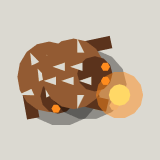 | [Imp](eternal-mood-imp.md) | 60 | Every Eternal Mood level, bursting out of vents, manholes and cracks as you come near |
| 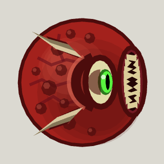 | [Cacodaemon](eternal-mood-cacodaemon.md) | 220 | Heck on Earth, the Foundry and Heck, floating over roofs and lava; the Mancouchbus and the Spider Mattressmind call more |
| 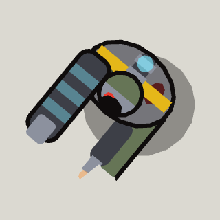 | [Mecha Zombie](eternal-mood-mecha-zombie.md) | 80 | Fobos Base, Heck on Earth and the Foundry, walking a loop round each Intern mob |
| 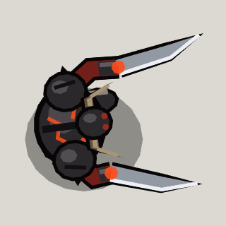 | [Dread Knight](eternal-mood-dread-knight.md) | 600 | Heck on Earth, the Foundry and Heck, each standing at his spot until you come near |
| 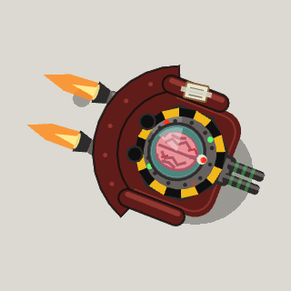 | **[The Floor Manager](eternal-mood-floor-manager.md)** | 2250 | Fobos Base, on the Hangar's lift; he wakes when you walk into the Hangar |
|  | **[The Mancouchbus](eternal-mood-mancubus.md)** | 3400 | Heck on Earth, in his recliner in front of the starport's gate; he wakes when you come up the Boulevard |
|  | **[The Baron of Heck](eternal-mood-baron.md)** | 4200 | The Foundry, on the stone ring round the Crucible; he wakes when you cross a bridge onto it, he sees you, or you shoot him |
|  | **[The Spider Mattressmind](eternal-mood-mattressmind.md)** | 5200 | Heck, on the Mattress's plateau before the Snooze Gate; it wakes when you come up onto the plateau |

## borderline

| | Enemy | Health | Where |
|---|---|---|---|
|  | [Junk hauler](borderline-jnk.md) | 30 | In packs on the Frozen Wreck, Liar's Landing and the Bragium Pit, picking over whatever is lying about; a hauler dock builds more |
|  | [Gun hauler](borderline-gun.md) | 70 | Everywhere on the line: standing watch, or walking a beat in squads |
|  | [Stalker hauler](borderline-stk.md) | 140 | Liar's Landing: a pair hunting the container stacks, and one in the last wave at the ferry lift |
|  | [Rocket hauler](borderline-rpg.md) | 120 | Standing watch from far back: under Liar's Landing's gantries, then Prosperity, the Assembly Line and Thousand Papercuts |
|  | [Medic drone](borderline-fix.md) | 25 | Hanging behind the haulers: Liar's Landing (and its lift's waves), Prosperity, the Refinery and the Assembly Line |
|  | [Shield drone](borderline-shd.md) | 25 | Hanging behind the haulers: the Bragium Pit, Prosperity, the Refinery, the Assembly Line and Thousand Papercuts |
|  | [Plasma hauler](borderline-plz.md) | 90 | Standing watch on the Bragium Pit's rings, then Prosperity, the Refinery and the Assembly Line |
|  | [Kamikaze hauler](borderline-exp.md) | 40 | In packs of three from Prosperity on |
|  | [Jet hauler](borderline-jet.md) | 70 | Standing watch in Prosperity and Thousand Papercuts |
|  | [Dozer hauler](borderline-dzr.md) | 160 | Standing watch in Prosperity, the Refinery and the Assembly Line |
|  | [Badass hauler](borderline-bad.md) | 450 | One a level from Prosperity on, with drones tending it |
|  | [Arc hauler](borderline-arc.md) | 80 | Standing watch in the Refinery's tunnels and in Thousand Papercuts |
|  | [Sentry](borderline-sen.md) | 90 | Flush in the floor of the Assembly Line and in Thousand Papercuts' rock |
|  | [Hauler dock](borderline-dck.md) | 300 | The Frozen Wreck: a charging bay at each post, guarding a terminal that opens the tunnel's blast door |
|  | [Rim cannon](borderline-can.md) | 120 | The Bunker: eleven round the rim of its roof; the way on stays shut until every one is down |
|  | **[Wilbur](borderline-wlb.md)** | 3000 | The Bragium Pit: he comes down onto the pad when you first set foot on the pit's floor (open once the four power terminals are hacked), and the mine lift stays shut until his keycard is picked up |
|  | [Max's screen](borderline-screen.md) | 450 | Prosperity: one in each corner district's square, up on two legs, a hauler dock guarding it; the north gate stays shut until all four are down |
|  | [Fabricator](borderline-fabricator.md) | 900 | The Assembly Line: one on a pad either side of the floor; the stairs up to the Foreman's floor stay shut until both are down |
