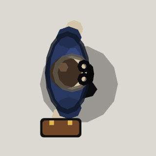

<!-- Written by tools/wiki/run.lua from the game's code (`make wiki`): change the game, not this page. -->

# A-Man (city event)

[Wiki](../README.md) / [Enemies](README.md) / The city

A man in a navy suit, joke-shop glasses and a stuck-on moustache. He never hurries: he teleports straight through you, and unpacks sentry turrets from his briefcase.

| | |
|---|---|
| **Where** | The city, as an event once the job "The man with the moustache" is done: he walks in from somewhere away from everyone |
| **Rank** | Boss |
| **Health** | 1400 |
| **Speed** | 55 px/s walking; the rest of the way he blinks |
| **Drops** | 50 koins, and his teleport in a random tier (legendary 3 times in a hundred) |

## Weapons

- **Blink**: every 3 to 5 s: within 600 px he goes straight through you and 220 px out the far side, further off he lands 240 px from you; 60 impact damage to everyone on the line, 14 px either side of it
- **Briefcase**: with a player within 900 px, he opens it on 8 sentry turrets that scuttle about spraying bursts of 4 rounds of 6 damage in random directions

## Abilities

- A line shows where he is about to blink, 0.8 s before he goes.
- A blink costs 45 of his 100 breath: two in a row and he walks until it is back. He never runs, so he is never winded.
- One horde of turrets at a time: 10 s after the last one falls he may open the case again.
- Under 40% health he goes for a medkit within 1600 px, blinking there when he can, and it puts back 200.
- Nothing hits him mid-blink.

## How to beat it

- Step off the line while it shows.
- One round of anything knocks a turret over.
- A freeze holds him and his wind-up waits; a stink in his face throws him off his aim.

---

_Health is for one player: it is multiplied by the number of players._
