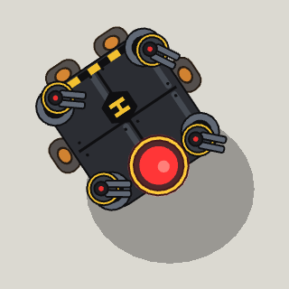

<!-- Written by tools/wiki/run.lua from the game's code (`make wiki`): change the game, not this page. -->

# BNK-9

[Wiki](../README.md) / [Enemies](README.md) / borderline

The bunker's flying core and the line's last boss: a slab of armour on four engines, a turret on each corner, and at its front the huge red eye it sees with.

| | |
|---|---|
| **Where** | The Bunker: it rises out of the eye's hatch once all eleven rim cannons are down, and flies over the roof; the way home opens when it crashes |
| **Rank** | Boss |
| **Health** | 6000 |
| **Speed** | 150 px/s in the air, 215 below half |
| **Sight** | 1400 px |
| **Drops** | 80 koins, a pickup, and a Bragium Bolter for every player (unlocking it) |

## Weapons

- **Eye laser**: parked, it charges its eye for 1 s (a red line to you, which follows you for 0.6 s), then a beam for 1.2 s: 70 fire a second, up to the first thing solid
- **Mines**: parked, 3 mines come down round you; they arm on landing, beep when you step within 55 px, and blow 0.6 s later: 34 explosive damage within 85 px
- **Corner turrets**: four, 300 health each, bursts of 5 at 8 bullet damage; one shot off grows back 16 s later (10 below half)

## Abilities

- It flies from spot to spot over the roof and parks 7 s (4.5 below half) to fight.
- Its eye is its weak spot: a hit there does 2x.
- A machine: no breath, no medkits.

## How to beat it

- Aim at the eye.
- Get out of the red line before the beam, and put something solid between you and it.
- Shoot its turrets off when it parks, then the eye while they grow back.

---

_Health is for one player: it is multiplied by the number of players. Each time the job has been finished before (up to 10), it has 25% more health and hits 15% harder._
