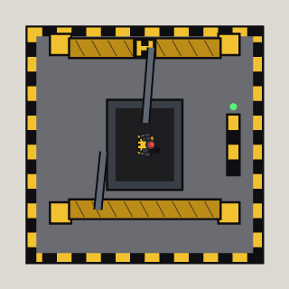

<!-- Written by tools/wiki/run.lua from the game's code (`make wiki`): change the game, not this page. -->

# Fabricator

[Wiki](../README.md) / [Enemies](README.md) / borderline

A gantry of welding arms over a cradle, building Hyperbole's haulers. It doesn't shoot; what it builds does.

| | |
|---|---|
| **Where** | The Assembly Line: one on a pad either side of the floor; the stairs up to the Foreman's floor stay shut until both are down |
| **Health** | 900 |
| **A blast** | takes 50 off it |
| **Drops** | nothing: the stairs open when the last one goes |

## Abilities

- While anyone is within 1100 px, a finished hauler walks out of it every 14 seconds (gun, junk, gun, kamikaze in turn), up to 3 of its own at once.

## How to beat it

- Rush it: the longer you're near, the more of its haulers there are.
- Rockets and grenades work: anything that touches the machine hurts it.

---

_Numbers are for a job nobody has finished yet. Each time it has been finished before (up to 10), this enemy has 10% more health and hits 10% harder._
