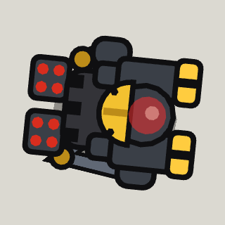

<!-- Written by tools/wiki/run.lua from the game's code (`make wiki`): change the game, not this page. -->

# Foreman BIG-B055

[Wiki](../README.md) / [Enemies](README.md) / borderline

The badass hauler that runs the line: bigger than any other, black and gold, a hard hat welded on, twin war cannons and rocket pods.

| | |
|---|---|
| **Where** | The Assembly Line: on the Foreman's floor up the stairs (open once both Fabricators are down), woken by the first player up there; the shipping bay stays shut until it is down |
| **Rank** | Boss |
| **Health** | 4000 |
| **Speed** | 80 px/s, 45 winded |
| **Sight** | 800 px |
| **Drops** | 50 koins and a pickup |

## Weapons

- **War cannons**: bursts of 4 (2 with one cannon), each a small blast: 16 explosive damage within 50 px
- **Rocket pods**: every 9 to 12 s it winds up for 0.9 s, then 7 rockets come down on red rings round you, 28 explosive damage each
- **Stomp**: at anyone within 112 px: it rears up for 0.55 s and stamps, 30 impact damage, thrown 220 px
- **Charge**: from half health, at anyone 220 px or more off every 6 to 8 s: a lane lights up for 0.8 s, then it runs down it at 520 px/s, 35 impact damage, thrown 300 px; into a wall and it is stunned 1.6 s

## Abilities

- Every 14 s (10 once it has torn a cannon off) it blows its whistle and the crane brings a hauler down on a red ring by you (20 impact within 60 px): gun, gun, rocket, kamikaze in turn, 3 out at most.
- At 50% of its health it tears one cannon off and starts charging.
- Under 40% health it goes for the nearest medkit within 700 px, for 200 health.

## How to beat it

- Step off the red ring when the whistle goes: the crane drops its hauler there.
- Make it charge you with a wall at your back, then step aside: it stuns itself.
- Shoot the medic drone on its floor first.

---

_Health is for one player: it is multiplied by the number of players. Each time the job has been finished before (up to 10), it has 25% more health and hits 15% harder._
