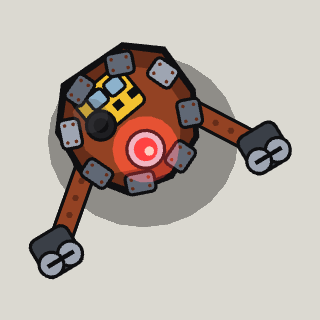

<!-- Written by tools/wiki/run.lua from the game's code (`make wiki`): change the game, not this page. -->

# Knuckle Scrapper

[Wiki](../README.md) / [Enemies](README.md) / borderline

A junk hauler that built itself huge out of Max's wrecked train: a heap of rusted scrap with a carriage panel on its back, the engine's headlight for an eye and bogies for fists. The line's first boss.

| | |
|---|---|
| **Where** | The Frozen Wreck: it builds itself out of the engine in front of the tunnel once the yard's three terminals are hacked, and the tunnel's blast door stays shut until it falls apart |
| **Rank** | Boss |
| **Health** | 1500 |
| **Speed** | 60 px/s, 35 winded |
| **Sight** | 800 px |
| **Drops** | 30 koins and a pickup |

## Weapons

- **Swing**: at anyone within 150 px in front of it: its fist goes back for 0.75 s, then sweeps round, 25 impact damage, thrown 260 px
- **Scrap**: at anyone 220 px or more off, every 4 to 6 s: it lifts a lump of itself for 0.9 s and lobs it onto a red ring, 30 impact damage within 75 px, thrown 160 px

## Abilities

- Every 9 s 2 junk haulers climb out of the wreck and make straight for it, 5 out at most; each that reaches it is pulled in and heals it 90.
- Under 40% health it goes for the nearest medkit within 700 px, for 200 health.
- Its plates come off as it's hurt, down to the bare frame.

## How to beat it

- Shoot the junk haulers carrying scrap before they reach it: every one heals it.
- Step back when its fist goes back; the swing only reaches what's in front of it.
- Keep moving off the red ring when it lifts a lump over its head.

---

_Health is for one player: it is multiplied by the number of players. Each time the job has been finished before (up to 10), it has 25% more health and hits 15% harder._
