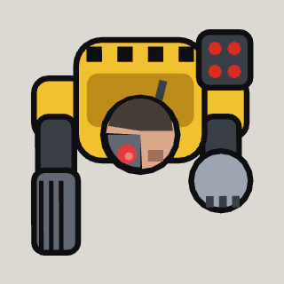

<!-- Written by tools/wiki/run.lua from the game's code (`make wiki`): change the game, not this page. -->

# Wilbur

[Wiki](../README.md) / [Enemies](README.md) / borderline

Maximum Maximilian Max's cyborg enforcer, more machine than man: a rotary gun for a right arm, a steel fist for a left, a rocket pod on his shoulder, and drones out of his back that keep him going.

| | |
|---|---|
| **Where** | The Bragium Pit: he comes down onto the pad when you first set foot on the pit's floor (open once the four power terminals are hacked), and the mine lift stays shut until his keycard is picked up |
| **Rank** | Boss |
| **Health** | 3000 |
| **Speed** | 95 px/s, 125 upgraded, 45 winded |
| **Sight** | 900 px |
| **Drops** | 40 koins, a pickup, his keycard, and a plasma rifle for every player (unlocking it) |

## Weapons

- **Rotary gun**: bursts of 10, 9 bullet damage each
- **Rocket pod**: the pod glows for 0.8 s, then 5 rockets come down on red rings round you, 30 explosive damage each; every 8 to 11 s (5 to 7 upgraded)
- **Leap**: at anyone 260 px or more off: he crouches for 0.7 s (a red ring where he'll land), is out of reach in the air for 0.8 s, and slams down: 40 impact damage within 110 px, thrown 220 px; at most every 7 s

## Abilities

- Every 15 s (7.5 upgraded) a drone out of his back, a shield drone and a medic drone by turns, 2 of his own out at most (3 upgraded): they heal him and shield him.
- At 50% of his health Max pushes an upgrade: quicker, sooner on the trigger, drones twice as often.
- Under 40% health he goes for the nearest medkit within 700 px, for 200 health.
- Coming down onto the pad, he throws everyone within 130 px flat.

## How to beat it

- Shoot his drones first: the medic heals him, the shield drone keeps a bubble on him.
- Get out of the red ring when he crouches; he comes up slow from a leap.
- Keep him running and he's winded: no leaps, no rockets.

---

_Health is for one player: it is multiplied by the number of players. Each time the job has been finished before (up to 10), it has 25% more health and hits 15% harder._
