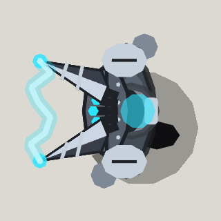

<!-- Written by tools/wiki/run.lua from the game's code (`make wiki`): change the game, not this page. -->

# Kilowatt

[Wiki](../README.md) / [Enemies](README.md) / Cyber Feud

The Static's boss: huge, loud, more machine than man, plated in gunmetal with a reactor for a heart and two insulator spikes on his back, a blue arc crackling between them. He fights alongside Director Saye, and comes for you up close.

| | |
|---|---|
| **Where** | The Roof, on the helipad, from the moment it wakes |
| **Rank** | Boss |
| **Health** | 2400 |
| **Speed** | 120 px/s coming at you, 40 winded, 540 charging |
| **Sight** | 700 px |
| **Drops** | 40 koins and 2 pickups |

## Weapons

- **Charge**: 40 impact damage and a shove of 140 px, about 486 px long down a line he braces on for 0.6 s (0.45 in phase 2), from 130 to 460 px off you, every 5 s (0.8 in phase 2)
- **Slam**: within 170 px he hops for 0.5 s and slams: a ring of shock rolls out to 230 px (330 in phase 2) at 520 px/s, 26 shock damage (a stun) to whoever it passes, every 6 s
- **Whip**: his fist crackles for 0.5 s and a line flickers out, then lightning goes down it out to 380 px: 22 shock damage to the first player on it and on to the next within 170 px, 3 players at most, every 4.5 s
- **Punch**: 30 impact damage right up against you, wound up for 0.35 s

## Abilities

- Vents every 4 moves (6 in phase 2): his chest cage opens for 3 s (4.5 in phase 2) and every hit on him does 2 times the damage, unless Saye's drones are round him.
- Phase 2 at half health: charges back to back, a wider slam, longer vents.
- Brutes come up the stairs to help him: the first 15 s into the fight, then every 25 s while fewer than 2 (1 more for each human past the first) are up.
- Shoot Saye and he holds a grudge: he goes for you, charging as soon as he can.
- With Saye down he melts down: phase 2 for good, and his slams leave shock patches 120 px round for 4 s (8 shock damage every 0.5 s).
- Charging into anything solid, he reels for 1 s.
- Goes for a medkit when badly hurt, dodges abilities about to land on him, and runs out of breath.
- Only players' rounds reach him.

## How to beat it

- Step off his line while he braces: once he goes he can't turn.
- Save your heavy hitting for his vents, and shoot Saye's drones off him first.
- Keep apart from your friends: his whip jumps from one of you to the next.

---

_Health is for one player: it is multiplied by the number of players. Each time the job has been finished before (up to 10), it has 25% more health and hits 15% harder._
