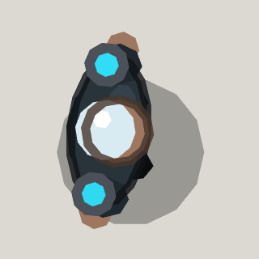

<!-- Written by tools/wiki/run.lua from the game's code (`make wiki`): change the game, not this page. -->

# General Volt

[Wiki](../README.md) / [Enemies](README.md) / Cyber Feud

The Static's general and Kilowatt's right hand: a long coat of cable, a Tesla coil on each shoulder and lightning for a temper. Nobody leaves the Market until he is down and somebody picks his pass code up off the floor.

| | |
|---|---|
| **Where** | The Market's Noodle Square, holding the loading dock's pass code |
| **Rank** | Boss |
| **Health** | 1800 |
| **Speed** | 85 px/s, 40 winded |
| **Sight** | 720 px |
| **Drops** | 30 koins, his pass code, and electric grenades for every player (unlocking them) |

## Weapons

- **Bolt**: 30 shock damage (a stun) to whoever is within 20 px of its line, out to 640 px; the line shows for 0.9 s first (0.65 in phase 2), set for the last 0.35 s; every 3.2 s (2.4 in phase 2)
- **Lightning grenade**: thrown up to 560 px every 7 s, landing 0.9 s later as a crackling field 110 px round for 4 s: 22 shock damage (a stun) on the first jolt, then 8 every 0.5 s while you stay
- **The storm**: lightning strikes round whoever is fighting him every 3.5 to 6 s (2.2 to 4 in phase 2), marked on the ground 1.1 s first: 20 shock damage within 55 px

## Abilities

- Waits in the square until a player steps into it or shoots him; then the rain starts and a storm breaks.
- Keeps 320 px from whoever he has.
- Shouts for backup at 75%, 50%, 25% of his health: a pack of 3 gangers and a sparker runs in from the lanes.
- Phase 2 at half health: his bolts come in a forked pair and he throws two grenades at once.
- Goes for a medkit when badly hurt, dodges abilities about to land on him, and runs out of breath.
- Only players' rounds reach him.

## How to beat it

- Step off his crackling line before it strikes: it holds still at the end.
- Keep out of the rings where his grenades and the storm's strikes will land.
- Hit him while he is winded, and thin out his backup before it gets to you.

---

_Health is for one player: it is multiplied by the number of players. Each time the job has been finished before (up to 10), it has 25% more health and hits 15% harder._
