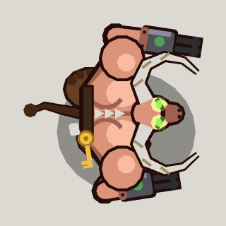

<!-- Written by tools/wiki/run.lua from the game's code (`make wiki`): change the game, not this page. -->

# The Baron of Heck

[Wiki](../README.md) / [Enemies](README.md) / Eternal Mood

A big horned brute on goat legs with guns for hands, the key to the Snooze Gate on his belt. Awake, he comes after you wherever you are, leaping the lava if he has to.

| | |
|---|---|
| **Where** | The Foundry, on the stone ring round the Crucible; he wakes when you cross a bridge onto it, he sees you, or you shoot him |
| **Rank** | Boss |
| **Health** | 4200 |
| **Speed** | 95 px/s, 45 winded |
| **Sight** | 900 px |
| **Drops** | 45 koins, maybe a pickup or two, the key, and a super shotgun for every player |

## Weapons

- **Green fire**: fire burns at both muzzles for 0.6 s, then a pair of fireballs, one at you and one where you're going; 22 fire damage each at 360 px/s. 1 pair a go (3 under half health, 0.35 s apart), every 2 to 2.8 s (1.4 to 2 under half)
- **Charge**: at anyone 220 px or more off: horns down for 0.55 s (a red lane on the floor), then 400 px/s for up to 1.1 s; 40 impact damage and 220 px of flying to whoever he hits. 30% of his attacks, 45% under half health
- **Leap**: at anyone 300 px or more off (landing no further than 560 px), and always at anyone across the lava: crouched for 0.6 s (a ring where he'll land), 0.75 s in the air, then 45 impact damage within 80 px and 200 px of flying; at most every 5 s
- **Claw**: within 65 px: gun arm back for 0.4 s, then 30 melee damage to everyone in front of him; at most every 1.3 s

## Abilities

- At two thirds and a third of his health he roars: everyone within 200 px is thrown back 180 px, and 3 imps climb out of the lava (more with more players).
- Dodges: a round about to hit him and he throws himself aside, at most every 1.8 s, if he has the breath. He gets out from under abilities too.
- Charging into a wall or the moat's edge, he stands stunned for 1.4 s.
- Under 40% health he goes for the nearest medkit within 700 px, for 200 health.
- Down, he drops the key: the portal stays sealed until somebody picks it up.

## How to beat it

- Stand in front of a wall when he lowers his horns, then step aside: he charges into it and stands stunned.
- He comes up slow from a leap, wide open for 0.6 s: be out of the ring, then shoot.
- Run him out of breath: winded, he can't dodge your rounds.
- A freeze holds him stiff.

---

_Health is for one player: it is multiplied by the number of players. Each time the job has been finished before (up to 10), it has 25% more health and hits 15% harder._
