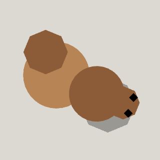

<!-- Written by tools/wiki/run.lua from the game's code (`make wiki`): change the game, not this page. -->

# Squirrel (loose)

[Wiki](../README.md) / [Enemies](README.md) / Shoeman's School of Survival

Bigfoot's squirrels, left behind without him. They pop out of the ground, sit a moment, then run at the nearest player and keep biting until somebody shoots them.

| | |
|---|---|
| **Where** | Shoeman's Scrap Yard: three waves, each bigger, out of the burrows in the far half of the yard |
| **Health** | 10: one round of anything |
| **Speed** | 230 px/s |
| **Sight** | 3000 px |

## Weapons

- **Bite**: 4 melee damage, then it runs off for 0.7 s and comes again

## Abilities

- Swerves after you, but overshoots a sharp dodge until it is within 140 px.
- Never gives up and never bursts on its own: it is there until it is shot.

## How to beat it

- Shoot it as it runs off after a bite: it goes in a straight line.
- Keep moving and keep a wreck between you and the burrows.
- Freezing and stink work on them.
