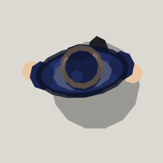

<!-- Written by tools/wiki/run.lua from the game's code (`make wiki`): change the game, not this page. -->

# Police officer

[Wiki](../README.md) / [Enemies](README.md) / The city

The law on foot. Officers stroll the streets around you, see crimes the way a patrol car does, and draw a pistol on anyone who is wanted.

| | |
|---|---|
| **Where** | The city's streets, walking a beat near every player |
| **Health** | 50 |
| **Hits** | 20 a hit, whatever hits them: 3 hits down one |
| **Speed** | 52 px/s on the beat, 155 chasing |
| **Sight** | 620 px |
| **On the street** | 1.5 per player, 8 at most, 2 more while anyone is wanted |

## Weapons

- **Pistol**: 20 damage a round, a round every 0.9 s, out to 520 px

## Abilities

- Witnesses crimes within 620 px and makes you wanted.
- Once after you, keeps after you out to 1150 px, closing to 110 px before standing to shoot.
- Calls it in over the radio: every free officer within 900 px comes.
- Loses you and searches the spot for 4 s before going back to the beat.
- Turns on whoever shoots them, wanted or not.

## How to beat it

- A car at 90 px/s or more flattens an officer outright.
- Break their line of sight: they can't see through buildings, and a crime nobody sees doesn't count.
