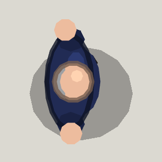

<!-- Written by tools/wiki/run.lua from the game's code (`make wiki`): change the game, not this page. -->

# Shoeman (city event)

[Wiki](../README.md) / [Enemies](README.md) / The city

The tutorial's teacher, done teaching: a big bald man in a navy t-shirt who believes a thrown shoe fixes most things. He walks the city throwing them at players and their buildings.

| | |
|---|---|
| **Where** | The city, as an event once the job "Shoeman's school of survival" is done: he walks in from somewhere away from everyone |
| **Rank** | Boss |
| **Health** | 1800 |
| **Speed** | 150 px/s running, 45 px/s walking or winded |
| **Drops** | 60 koins |

## Weapons

- **Shoe**: every 5 s at the nearest player he can see within 650 px (with nobody within 1000 px, the nearest building a player owns): it kills whatever it touches, players on foot, cars and enemies, flies on through them and takes 250 off the wall it stops at

## Abilities

- He shouts "DODGE!!!!" as he winds up, and the shoe goes where you stand 0.816 s later, when it leaves his hand.
- Running spends his breath (18 a second); winded, he walks until he has 50 back.
- Under 40% health he goes for a medkit within 700 px, and it puts back 200.

## How to beat it

- Dodge once the shoe is in the air, not while he winds up: he aims where you stand when he lets go.
- A wall between you and him stops the shoe, though the wall takes the hit.
- A freeze holds him and his throw waits; a stink in his face sends him running.

---

_Health is for one player: it is multiplied by the number of players._
