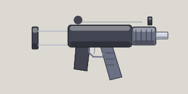
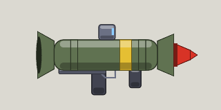
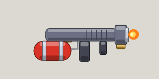
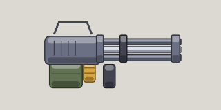

<!-- Written by tools/wiki/run.lua from the game's code (`make wiki`): change the game, not this page. -->

# Weapons

[Wiki](../README.md) / Weapons

Every gun a player can carry: what it does in each tier, what it costs and where it is won. Numbers are for a common one.

Everything comes in four tiers. Uncommon improves its first stat by 15% and costs 2.5 times as much; Rare improves its first two stats by 25% and costs 6 times as much; Legendary improves every stat by 35% and costs 15 times as much. Each page lists the stats in the order a tier improves them.

| | Gun | Damage | Fire rate | Magazine | Get it |
|---|---|---|---|---|---|
|  | [Pistol](pistol.md) | 20 | 5.0 a second | 15 | 40 Fcks |
|  | [Uzi](uzi.md) | 12 | 14.3 a second | 30 | won, then 90 Fcks |
|  | [SMG](smg.md) | 13 | 15.4 a second | 30 | won, then 110 Fcks |
|  | [AK-47](ak47.md) | 18 | 9.1 a second | 30 | 120 Fcks |
|  | [AR](ar.md) | 15 | 11.8 a second | 30 | won, then 140 Fcks |
|  | [Shotgun](shotgun.md) | 11 x 6 pellets | 1.1 a second | 6 | 100 Fcks |
|  | [Super shotgun](super-shotgun.md) | 11 x 12 pellets | 1.1 a second | 10 | won, then 260 Fcks |
|  | [Rocket launcher](rocket.md) | 90 | 1.3 a second | 1 | 300 Fcks |
|  | [Sniper rifle](sniper.md) | 200 | 0.8 a second | 5 | 160 Fcks |
|  | [Flamethrower](flamethrower.md) | 5 | 14.3 a second | 100 | 220 Fcks |
|  | [Minigun](minigun.md) | 10 | 16.7 a second | 150 | 420 Fcks |
