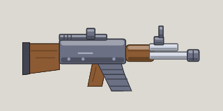

<!-- Written by tools/wiki/run.lua from the game's code (`make wiki`): change the game, not this page. -->

# AK-47

[Wiki](../README.md) / [Weapons](README.md) / AK-47

A rifle: nine 7.62 rounds a second with hardly any scatter.

**How to use it:** Drag it into a weapon slot; its number key picks it.

| | |
|---|---|
| **Damage type** | bullet |

## Stats by tier

| | Common | Uncommon | Rare | Legendary |
|---|---|---|---|---|
| **damage** | 18 | **21** | **23** | **24** |
| **fire rate** | 9.1 a second | 9.1 a second | **11.4 a second** | **12.3 a second** |
| **magazine** | 30 | 30 | 30 | **41** |
| **reload** | 2 s | 2 s | 2 s | **1.5 s** |
| **scatter** | 2 degrees | 2 degrees | 2 degrees | 2 degrees |
| **ammo** | 7.62 rounds | 7.62 rounds | 7.62 rounds | 7.62 rounds |
| **better by** | - | +15% damage | +25% damage, cooldown | +35% all |
| **price** | 120 Fcks | 300 Fcks | 720 Fcks | 1800 Fcks |

_What a tier improves is in **bold**._

## How to get it

- In the shop, in every tier: 120 Fcks for a common one.
