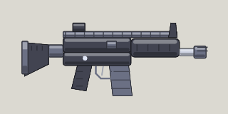

<!-- Written by tools/wiki/run.lua from the game's code (`make wiki`): change the game, not this page. -->

# AR

[Wiki](../README.md) / [Weapons](README.md) / AR

An assault rifle: twelve 7.62 rounds a second, the straightest-shooting rifle there is. Fires the AK's 7.62 rounds.

**How to use it:** Drag it into a weapon slot; its number key picks it.

| | |
|---|---|
| **Damage type** | bullet |

## Stats by tier

| | Common | Uncommon | Rare | Legendary |
|---|---|---|---|---|
| **damage** | 15 | **17** | **19** | **20** |
| **fire rate** | 11.8 a second | 11.8 a second | **14.7 a second** | **15.9 a second** |
| **magazine** | 30 | 30 | 30 | **41** |
| **reload** | 1.7 s | 1.7 s | 1.7 s | **1.3 s** |
| **scatter** | 1 degrees | 1 degrees | 1 degrees | 1 degrees |
| **ammo** | 7.62 rounds | 7.62 rounds | 7.62 rounds | 7.62 rounds |
| **better by** | - | +15% damage | +25% damage, cooldown | +35% all |
| **price** | 140 Fcks | 350 Fcks | 840 Fcks | 2100 Fcks |

_What a tier improves is in **bold**._

## How to get it

- Won first: once you have picked one up, the shop sells it to you, in every tier.
- Dropped by [General Volt](../enemies/cyber-feud-volt.md) (Cyber Feud): 30 koins, his pass code, and electric grenades and an AR for every player (unlocking them both).
