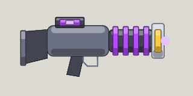

<!-- Written by tools/wiki/run.lua from the game's code (`make wiki`): change the game, not this page. -->

# Bragium Bolter

[Wiki](../README.md) / [Weapons](README.md) / Bragium Bolter

The Bragium Bolter: hold fire to charge, let go for one big ball of plasma that bursts where it lands and melts armor. Charged all the way, nothing on foot walks away.

**How to use it:** Drag it into a weapon slot; its number key picks it.

| | |
|---|---|
| **Damage type** | plasma |
| **Blast type** | plasma |

## Stats by tier

| | Common | Uncommon | Rare | Legendary |
|---|---|---|---|---|
| **blast damage** | 70 | 70 | **88** | **95** |
| **blast radius** | 90 px | 90 px | 90 px | 90 px |
| **fire rate** | 1.7 a second | 1.7 a second | 1.7 a second | 1.7 a second |
| **magazine** | 4 | 4 | 4 | **5** |
| **reload** | 2.8 s | 2.8 s | 2.8 s | **2.1 s** |
| **scatter** | none | none | none | none |
| **ammo** | Bragium cells | Bragium cells | Bragium cells | Bragium cells |
| **better by** | - | +15% damage | +25% damage, blast | +35% all |
| **price** | 380 Fcks | 950 Fcks | 2280 Fcks | 5700 Fcks |

_What a tier improves is in **bold**._

## How to get it

- Won first: once you have picked one up, the shop sells it to you, in every tier.
- Dropped by [BNK-9](../enemies/borderline-bnk.md) (borderline): 80 koins, a pickup, and a Bragium Bolter for every player (unlocking it).
