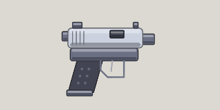

<!-- Written by tools/wiki/run.lua from the game's code (`make wiki`): change the game, not this page. -->

# Pistol

[Wiki](../README.md) / [Weapons](README.md) / Pistol

Hits hard and straight, and never runs out of rounds. Everyone starts with one.

**How to use it:** Drag it into a weapon slot; its number key picks it.

| | |
|---|---|
| **Damage type** | bullet |

## Stats by tier

| | Common | Uncommon | Rare | Legendary |
|---|---|---|---|---|
| **damage** | 20 | **23** | **25** | **27** |
| **fire rate** | 5.0 a second | 5.0 a second | **6.3 a second** | **6.8 a second** |
| **magazine** | 15 | 15 | 15 | **20** |
| **reload** | 1.2 s | 1.2 s | 1.2 s | **0.9 s** |
| **scatter** | none | none | none | none |
| **ammo** | never runs out | never runs out | never runs out | never runs out |
| **better by** | - | +15% damage | +25% damage, cooldown | +35% all |
| **price** | 40 Fcks | 100 Fcks | 240 Fcks | 600 Fcks |

_What a tier improves is in **bold**._

## How to get it

- Everyone starts with one.
- In the shop, in every tier: 40 Fcks for a common one.
