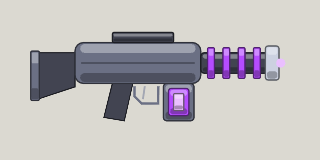

<!-- Written by tools/wiki/run.lua from the game's code (`make wiki`): change the game, not this page. -->

# Plasma rifle

[Wiki](../README.md) / [Weapons](README.md) / Plasma rifle

An assault rifle firing balls of plasma, nine a second, 45 to a magazine. Plasma melts armor: what they wear stops half as much. Fires the AK's 7.62 rounds.

**How to use it:** Drag it into a weapon slot; its number key picks it.

| | |
|---|---|
| **Damage type** | plasma |

## Stats by tier

| | Common | Uncommon | Rare | Legendary |
|---|---|---|---|---|
| **damage** | 25 | **29** | **31** | **34** |
| **fire rate** | 9.1 a second | 9.1 a second | **11.4 a second** | **12.3 a second** |
| **magazine** | 45 | 45 | 45 | **61** |
| **reload** | 2.2 s | 2.2 s | 2.2 s | **1.6 s** |
| **scatter** | 2 degrees | 2 degrees | 2 degrees | 2 degrees |
| **ammo** | 7.62 rounds | 7.62 rounds | 7.62 rounds | 7.62 rounds |
| **better by** | - | +15% damage | +25% damage, cooldown | +35% all |
| **price** | 180 Fcks | 450 Fcks | 1080 Fcks | 2700 Fcks |

_What a tier improves is in **bold**._

## How to get it

- Won first: once you have picked one up, the shop sells it to you, in every tier.
- Dropped by [Wilbur](../enemies/borderline-wlb.md) (borderline): 40 koins, a pickup, his keycard, and a plasma rifle for every player (unlocking it).
