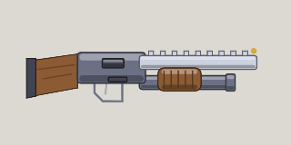

<!-- Written by tools/wiki/run.lua from the game's code (`make wiki`): change the game, not this page. -->

# Shotgun

[Wiki](../README.md) / [Weapons](README.md) / Shotgun

Six pellets a pull that fill a doorway. Brutal up close, spent by about 250 px.

**How to use it:** Drag it into a weapon slot; its number key picks it.

| | |
|---|---|
| **Damage type** | bullet |

## Stats by tier

| | Common | Uncommon | Rare | Legendary |
|---|---|---|---|---|
| **damage** | 11 x 6 pellets | **13 x 6 pellets** | **14 x 6 pellets** | **15 x 6 pellets** |
| **fire rate** | 1.1 a second | 1.1 a second | **1.4 a second** | **1.5 a second** |
| **range** | about 260 px | about 260 px | about 260 px | about 260 px |
| **magazine** | 6 | 6 | 6 | **8** |
| **reload** | 2.4 s | 2.4 s | 2.4 s | **1.8 s** |
| **scatter** | 9 degrees | 9 degrees | 9 degrees | 9 degrees |
| **ammo** | shells | shells | shells | shells |
| **better by** | - | +15% damage | +25% damage, cooldown | +35% all |
| **price** | 100 Fcks | 250 Fcks | 600 Fcks | 1500 Fcks |

_What a tier improves is in **bold**._

## How to get it

- In the shop, in every tier: 100 Fcks for a common one.
