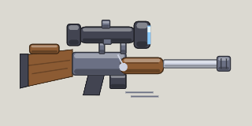

<!-- Written by tools/wiki/run.lua from the game's code (`make wiki`): change the game, not this page. -->

# Sniper rifle

[Wiki](../README.md) / [Weapons](README.md) / Sniper rifle

One round drops anyone on foot. Hold right mouse for a 4x scope.

**How to use it:** Drag it into a weapon slot; its number key picks it.

| | |
|---|---|
| **Damage type** | bullet |

## Stats by tier

| | Common | Uncommon | Rare | Legendary |
|---|---|---|---|---|
| **damage** | 200 | **230** | **250** | **270** |
| **fire rate** | 0.8 a second | 0.8 a second | **1.0 a second** | **1.0 a second** |
| **range** | about 1890 px | about 1890 px | about 1890 px | about 1890 px |
| **magazine** | 5 | 5 | 5 | **7** |
| **reload** | 5 s | 5 s | 5 s | **3.7 s** |
| **scatter** | none | none | none | none |
| **scope** | x4 | x4 | x4 | x4 |
| **ammo** | sniper rounds | sniper rounds | sniper rounds | sniper rounds |
| **better by** | - | +15% damage | +25% damage, cooldown | +35% all |
| **price** | 160 Fcks | 400 Fcks | 960 Fcks | 2400 Fcks |

_What a tier improves is in **bold**._

## How to get it

- In the shop, in every tier: 160 Fcks for a common one.
