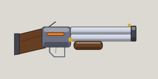

<!-- Written by tools/wiki/run.lua from the game's code (`make wiki`): change the game, not this page. -->

# Super shotgun

[Wiki](../README.md) / [Weapons](README.md) / Super shotgun

The Mood Slayer's own. Twelve pellets a pull that reach twice as far as a shotgun's, and ten shells between reloads. Fires shotgun shells.

**How to use it:** Drag it into a weapon slot; its number key picks it.

| | |
|---|---|
| **Damage type** | bullet |

## Stats by tier

| | Common | Uncommon | Rare | Legendary |
|---|---|---|---|---|
| **damage** | 11 x 12 pellets | **13 x 12 pellets** | **14 x 12 pellets** | **15 x 12 pellets** |
| **fire rate** | 1.1 a second | 1.1 a second | **1.4 a second** | **1.5 a second** |
| **range** | about 510 px | about 510 px | about 510 px | about 510 px |
| **magazine** | 10 | 10 | 10 | **14** |
| **reload** | 2.8 s | 2.8 s | 2.8 s | **2.1 s** |
| **scatter** | 9 degrees | 9 degrees | 9 degrees | 9 degrees |
| **ammo** | shells | shells | shells | shells |
| **better by** | - | +15% damage | +25% damage, cooldown | +35% all |
| **price** | 260 Fcks | 650 Fcks | 1560 Fcks | 3900 Fcks |

_What a tier improves is in **bold**._

## How to get it

- Won first: once you have picked one up, the shop sells it to you, in every tier.
- Dropped by [The Baron of Heck](../enemies/eternal-mood-baron.md) (Eternal Mood): 45 koins, maybe a pickup or two, the key, and a super shotgun for every player.
