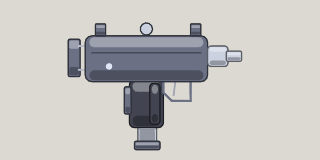

<!-- Written by tools/wiki/run.lua from the game's code (`make wiki`): change the game, not this page. -->

# Uzi

[Wiki](../README.md) / [Weapons](README.md) / Uzi

Sprays fourteen 9mm rounds a second, but they're spent by about 360 px: deadly up close, useless far off. Fires the pistol's 9mm rounds.

**How to use it:** Drag it into a weapon slot; its number key picks it.

| | |
|---|---|
| **Damage type** | bullet |

## Stats by tier

| | Common | Uncommon | Rare | Legendary |
|---|---|---|---|---|
| **damage** | 12 | **14** | **15** | **16** |
| **fire rate** | 14.3 a second | 14.3 a second | **17.9 a second** | **19.3 a second** |
| **range** | about 360 px | about 360 px | about 360 px | about 360 px |
| **magazine** | 30 | 30 | 30 | **41** |
| **reload** | 1.8 s | 1.8 s | 1.8 s | **1.3 s** |
| **scatter** | 5 degrees | 5 degrees | 5 degrees | 5 degrees |
| **ammo** | 9mm rounds | 9mm rounds | 9mm rounds | 9mm rounds |
| **better by** | - | +15% damage | +25% damage, cooldown | +35% all |
| **price** | 90 Fcks | 225 Fcks | 540 Fcks | 1350 Fcks |

_What a tier improves is in **bold**._

## How to get it

- Won first: once you have picked one up, the shop sells it to you, in every tier.
- Dropped by [Crazy Karen](../enemies/karen-boss.md) (Karen's Cul-de-sac): 30 koins, and an uzi for every player.
